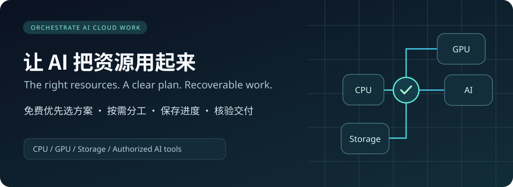
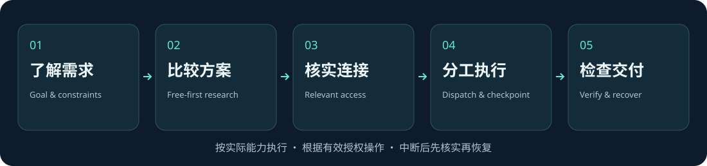

# AI 算力与工具协作技能



[快速开始](#怎么开始) · [执行入口](SKILL.md) · [使用指引](references/usage.md) · [English](#english-documentation)

让 dot、bot、muse、Codex、Claude 等 AI 助手，根据任务需要使用 CPU、云端 GPU、云盘和已获授权的 AI 服务。适用于编程、研究、数据分析、媒体制作等工作，不限于视频，也不要求一定有云端电脑。

核心执行说明保留英文，方便不同助手读取；本页先介绍中文用法，后面保留完整英文说明。

## 从需求到交付



| 先选对资源 | 再把任务安排好 | 让结果有据可查 |
| :--- | :--- | :--- |
| 查证免费方案、额度与限制，按目标和预算选择。 | 检查在跑任务，拆分独立工作，避免重复提交。 | 保存检查点，核验最终成果与备份，再按授权清理。 |

## 它能帮你做什么

- 根据目标、预算和已有资源，查找当前可用的免费方案，说明优缺点与限制；预算允许时，也可提供少量付费备选。
- 检查已有连接，只在任务确实需要时提醒你登录对应网站。
- 查看实际算力、剩余额度和正在运行的任务，再分配工作。适合 CPU 的工作不占 GPU。
- 将不同任务分给不同资源，保存进度和检查点，避免断线后全部重来或重复提交。
- 记录实际学习过的资料、可借鉴的方法和试验结果，逐步改进工作方式。
- 检查最终成果，核验备份能否恢复，再按你的有效授权清理文件、释放空闲运行时。

## 怎么开始

1. 下载完整技能文件夹，通过所用工具支持的技能加载或文件读取方式交给 AI，保留文件之间的相对路径。
2. 告诉 AI 你要完成什么、需要什么成果，以及预算或限制。已经说过的内容无需重复。
3. 让 AI 先核实自己能用哪些工具，再给出适合你的方案。需要登录时，它应说明网站、用途和所需访问权限，引导你在官方页面或安全登录界面完成。

可以直接这样说：

> 使用 orchestrate-ai-cloud-work。我要整理一份研究报告，只用免费资源。先了解我的需求，查找适合的方案，说明限制，再检查需要哪些工具和登录。

> 使用这个技能继续我的代码项目。先找出已完成的部分和正在运行的任务，再安排剩下的工作，不要重复执行。

支持按名称调用技能的客户端可以使用 `$orchestrate-ai-cloud-work`；其他助手可读取 SKILL.md 和相关参考文件。各客户端的安装方式、浏览器控制和代码执行能力不同，不能保证自动兼容。详细操作见 [使用指引](references/usage.md#中文使用指引)。

## 第一次使用会发生什么

AI 应先从上下文了解你的目标、成果形式、预算和已有资源，只补问缺失的信息。需要选方案时先比较，再引导必要的登录。已经能用的连接不反复要求登录；你暂时不想连接某项服务时，它应继续完成不依赖该服务的工作。

安装技能本身不会启动后台任务，也不会让 AI 自动获得账号、权限或 GPU。

## 常见问题与边界

- **加载了却不能操作？** 先确认当前助手具备相应的浏览器、文件、代码执行或连接器能力。技能提供做事方法，不会凭空添加工具。
- **免费额度用不了？** 核实当前平台规则和账号实际状态，再考虑其他符合要求的方案。免费额度、试用资格和 GPU 分配都不是保证。
- **多块显卡能合成一块大显存吗？** 不能自动合并。内存、单卡显存、本地磁盘和云盘容量需要分别记录。
- **为什么还要确认？** 方案建议不等于购买、上传、授权新权限或删除文件的许可。应遵循当前有效授权。
- **登录能一直保持吗？** 不能保证。会话可能失效，需要重新核实；不要把密码、令牌或 Cookie 发到聊天或写进项目记录。

脚本只做离线任务清单检查，不会联网、提交云端任务或替你授权。已有付费订阅、云盘费用和开源工具的托管成本应单独说明，不能算成全免费。

## English documentation


A reusable workflow for AI assistants and tools such as dot, bot, muse, Codex, and Claude. Allocate CPU, cloud GPUs, storage, and authorized AI tools according to the task; save progress and avoid duplicate work and wasted compute.

The package uses a standard SKILL.md layout. Use it with whatever browser, file, code-execution, or connector capabilities the current environment provides. A dedicated cloud computer is not required, and browser control is not assumed to exist in every client.

## Capabilities

- Research current free-first options for the user's scenario, compare tradeoffs, and let the user choose where needed.
- On first use, check task-relevant connections and proactively request missing sign-ins.
- Inspect actual resources, quotas, and running jobs before allocation.
- Divide independent inputs across workers without submitting the same batch twice.
- Recover from disconnections using task records, hashes, and checkpoints.
- Turn reference study into documented experiments and reusable lessons.
- Verify final outputs and recoverable backups before authorized cleanup.
- Apply optional video and narration guidance when relevant.

## Load and use

Give the entire folder to an assistant through its supported skill-loading or file-reading interface. Preserve relative paths. An assistant must be able to read the instructions, have suitable tools for each action, and hold the required authorization. With only some capabilities available, complete supported work and identify the remaining blockers. Clients differ: automatic installation, API compatibility, and access to services are not guaranteed.

Example request:

> Use orchestrate-ai-cloud-work. Help me prepare for my project: ask only for missing goals and constraints, recommend the resources I actually need, check existing connections, and guide me through any necessary login.

Clients supporting named skill invocation can use `$orchestrate-ai-cloud-work`. Other agents can read SKILL.md and the relevant reference files directly. `agents/openai.yaml` is optional Codex metadata and may be ignored by other clients.

See [usage](references/usage.md). Copy the configuration and task templates under assets, fill real values, and run:

```sh
python scripts/validate_manifest.py /path/to/task-manifest.json
python -m unittest discover -s tests -v
```

The checker uses Python's standard library and performs offline checks only. It does not contact providers, verify actual quota or file content, submit jobs, or authorize actions.

## Layout

- SKILL.md: entry point and conditional reference routing
- references/: scheduling, AI collaboration, learning, quality, video/narration, usage
- assets/: blank project/task templates and an optional UI icon
- scripts/: read-only manifest checker
- tests/: reproducible CPU-only tests
- agents/: optional client metadata

## Limits

This package supplies no GPU, storage, subscription, or persistent login. Free allocation can change. Multiple GPUs do not automatically pool VRAM. Existing paid storage and subscriptions must be accounted for separately. Uploading, payment, account changes, and deletion remain subject to effective authorization.

Public reference projects are linked in [AI collaboration and learning](references/ai-and-learning.md); their source code and private media are not bundled. No open-source license has been selected. Public visibility alone does not grant additional usage rights.

## First-use connections

On first active use, the assistant learns the task and missing constraints, proposes a suitable setup, then checks which services are actually needed and whether they are already connected. It asks you to sign in only where access is missing, explains why, then verifies access before continuing. Installing this skill does not independently launch a background process. See [connection onboarding](references/connection-onboarding.md).
